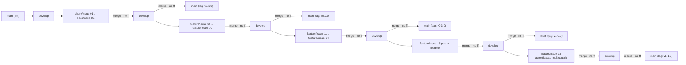

# LIBRARYTRIX // SISTEMA_ARQUIVO (DB-01)


> **Catálogo Literário, Crítica Pessoal e Estação de Telemetria em Estilo Cyberpunk Terminal HUD (100% PT-BR).**  
> Aplicação Web Progressiva (PWA) multiusuário com autenticação segura (**Firebase Auth** + fallback criptográfico local **`SHA-256` + salt**), isolamento estrito de acervo por conta e persistência híbrida **Offline-First** (**Cloud Firestore** + **`localStorage`**).

---

## 1. O Problema Resolvido

Leitores assíduos, estudantes e pesquisadores frequentemente espalham suas anotações de leitura em planilhas, aplicativos genéricos de notas ou plataformas comerciais engessadas que:
1. Não oferecem um **limite estruturado para síntese crítica** nem indicadores visuais imediatos da nota e da distribuição do acervo.
2. Não permitem criar **categorias próprias com identidade cromática livre** (código hexadecimal personalizado e sufixo de catalogação).
3. Misturam dados de diferentes usuários no mesmo dispositivo ou deixam de funcionar quando não há conexão com a internet.

O **Librarytrix (`SISTEMA_ARQUIVO`)** soluciona esses três pontos ao combinar uma interface tática de alta densidade (**Cyberpunk Terminal HUD**, geometria `0px`, scanlines e tipografia `Space Grotesk` / `JetBrains Mono`) com **isolamento multiusuário por `uid`**, **críticas literárias de até 1000 caracteres**, **telemetria dinâmica em 4 blocos** e **busca instantânea sem acentos em 4 campos**.

---

## 2. Sumário de Funcionalidades: Implementadas vs. Planejadas

### ✅ Funcionalidades Implementadas (`v1.1.0`)
- [x] **Autenticação Multiusuário e Segurança (`AuthTerminal` & `authService`):**
  - Abas `[ AUTENTICAR OPERADOR ]` (Login) e `[ REGISTRAR NOVO OPERADOR ]` (Cadastro com Codinome, E-mail, Senha e Confirmação).
  - Validação de força de senha no frontend (mínimo de 8 caracteres, 1 maiúscula, 1 minúscula e 1 número/símbolo) com medidor visual em barras neon (`FRACA` `#ff007f`, `MÉDIA` `#ffb800`, `FORTE` `#39ff14`) e botão `[ MOSTRAR / OCULTAR ]`.
  - Integração primária com **Firebase Authentication** e fallback local seguro usando `window.crypto.subtle.digest('SHA-256', ...)` com *salt* exclusivo por operador (nunca armazena senhas em texto puro) + bloqueio contra força bruta (5 tentativas).
  - Identificação real do operador logado (nome + iniciais no avatar) e botão `[ ENCERRAR SESSÃO ]` no cabeçalho e na Sidebar com limpeza imediata do estado em memória.
- [x] **Isolamento Estrito de Dados por Conta (`storageService` & `firestore.rules`):**
  - Subcoleções isoladas no Firestore (`users/{uid}/books` e `users/{uid}/categories`) e chaves isoladas no `localStorage` (`librarytrix_books_${uid}` e `librarytrix_categories_${uid}`).
  - Regras de segurança `firestore.rules` garantindo `request.auth != null && request.auth.uid == userId` e validando `critique.size() <= 1000` diretamente no banco.
- [x] **CRUD Completo de Livros e Avaliação HUD:**
  - Cadastro, edição e exclusão com protocolo sequencial automático (`ID_ARQUIVO // NNNN-SUF`), nota decimal (`0.0` a `5.0 ★`) e barra HUD segmentada de 5 células (`RatingBar`).
- [x] **Terminal de Crítica V4.0 (Limite Estrito de 1000 Caracteres):**
  - Campo de crítica com `maxLength={1000}`, validação `critique.length <= 1000`, contador em tempo real `CARACTERES: XXX / 1000` (amarelo `#ffb800` > 900; magenta `#ff007f` em 1000), atalho `CTRL+ENTER` e modal de leitura `[ VER CRÍTICA COMPLETA ]`.
- [x] **Gestão Dinâmica de Categorias com Código Hexadecimal Livre:**
  - Criação de categorias (`+ NOVA CATEGORIA` / `ALT+N`) com presets Neon Phosphor, input hexadecimal customizado (`/ ^#([0-9A-F]{3}){1,2}$/i`), seletor `<input type="color">` sincronizado e preview em tempo real da etiqueta (`style` inline dinâmico).
  - Exclusão segura de categorias (`CONFIRMAR EXCLUSÃO`) com migração automática dos livros vinculados para a categoria protegida `GERAL` (`#849495`).
- [x] **4 Blocos Superiores de Telemetria Dinâmica (`TelemetryStrip`):**
  - Bloco 1 (`REGISTROS // TOTAL` | `SIS:ATIVO`), Bloco 2 (`MÉTRICA // GERAL` ou `MÉTRICA // [CATEGORIA]` com cor dinâmica), Bloco 3 (`ÚLTIMO REGISTRO // ADIÇÃO`) e Bloco 4 (`DADOS // DOMINÂNCIA` / `MAIOR CATEGORIA`).
- [x] **Busca Multicritério em 4 Campos (Insensível a Acentos) e Filtros:**
  - Barra `BUSCAR >` (Desktop e Mobile, atalho `CTRL+K`, botão `[ X ]`) com normalização Unicode `NFD` pesquisando simultaneamente em **Título**, **Autor**, **Nacionalidade Original** e **Categoria**, além de estado vazio com `[ LIMPAR FILTROS ]`.
- [x] **Ranking Geral, Exportação JSON e PWA Offline-First:**
  - Visão `RANKING // CLASSIFICAÇÃO GERAL` (`#01`–`#03`), exportação `.json` (`[ SALVAR PACOTE DE DADOS ]`) e suporte PWA instalável.

### 🗺️ Funcionalidades Planejadas (Backlog de Evolução `v2.0`)
- [ ] Importação de arquivo `.json` para restauração de backup externo pela interface.
- [ ] Integração opcional com API pública (OpenLibrary / Google Books) para preenchimento automático de capa e ano por ISBN.
- [ ] Edição direta do nome e da cor hexadecimal de uma categoria já existente com propagação em lote.
- [ ] Modo de compartilhamento público de link somente-leitura para o perfil literário do operador.

---

## 3. Configuração de Ambiente, Instalação e Execução Local

### Pré-requisitos
- **Node.js** `>= 18.0.0` e **npm** `>= 9.0.0`
- **Git** `>= 2.30`

### Passo a Passo Rápido

```bash
# 1. Clone o repositório
git clone https://github.com/Glins-dev/librarytrix.git
cd librarytrix

# 2. Instale as dependências
npm install

# 3. (Opcional) Configure as variáveis de ambiente do Firebase
cp .env.example .env

# 4. Inicie o servidor de desenvolvimento (http://localhost:5173)
npm run dev
```

> **Nota sobre o Modo Offline-First:** Mesmo **sem** criar o arquivo `.env`, o Librarytrix funciona integralmente utilizando o cofre criptográfico local (`SHA-256 + salt`) e o `localStorage` isolado por usuário.

### Configuração do `.env` (Opcional — Firebase Auth & Cloud Firestore)
Copie o arquivo `.env.example` para `.env` e preencha com as credenciais do seu projeto no [Firebase Console](https://console.firebase.google.com/):

```env
VITE_FIREBASE_API_KEY=sua_api_key
VITE_FIREBASE_AUTH_DOMAIN=seu-projeto.firebaseapp.com
VITE_FIREBASE_PROJECT_ID=seu-projeto
VITE_FIREBASE_STORAGE_BUCKET=seu-projeto.appspot.com
VITE_FIREBASE_MESSAGING_SENDER_ID=000000000000
VITE_FIREBASE_APP_ID=1:000000000000:web:abcdef123456
```

Para aplicar as regras de segurança do banco de dados no Firebase, utilize o arquivo [`firestore.rules`](firestore.rules) na raiz do projeto.

### Scripts Disponíveis no `package.json`

| Comando | Descrição |
|---------|-----------|
| `npm run dev` | Inicia o servidor Vite com Hot Module Replacement (HMR) em `http://localhost:5173`. |
| `npm test` | Executa a suíte completa de **23 testes unitários automatizados** (`vitest run`) cobrindo `storageService` e `authService`. |
| `npm run test:watch` | Executa o Vitest em modo interativo (*watch mode*) durante o desenvolvimento. |
| `npm run typecheck` | Executa o compilador TypeScript (`tsc --noEmit`) em modo estrito para verificação de tipos. |
| `npm run build` | Compila TypeScript (`tsc -b`), gera o bundle otimizado de produção em `dist/` e o Service Worker PWA. |
| `npm run preview` | Serve a versão compilada de produção localmente para validação final. |

---

## 4. Documentação de Engenharia de Software (`docs/`)

Toda a documentação acadêmica e arquitetural do projeto encontra-se na pasta [`docs/`](docs/):

| Artefato | Link Direto | Conteúdo Principal |
|----------|-------------|--------------------|
| **Termo de Abertura (Project Charter)** | [`docs/project-charter.md`](docs/project-charter.md) | Justificativa, visão geral, **5 Objetivos SMART**, escopo *In/Out*, tabela de Stakeholders e matriz de riscos. |
| **Especificação de Requisitos** | [`docs/requisitos.md`](docs/requisitos.md) | Requisitos Funcionais **`[RF01]` a `[RF15]`**, Requisitos Não Funcionais **`[RNF01]` a `[RNF10]`** e Matriz de Rastreabilidade. |
| **Casos de Uso** | [`docs/casos-de-uso.md`](docs/casos-de-uso.md) | Atores formais, diagrama Mermaid e fluxos principais, alternativos e de exceção (`UC01` a `UC07`). |
| **User Stories (BDD / Gherkin)** | [`docs/user-stories.md`](docs/user-stories.md) | Histórias de usuário no formato canônico acompanhadas de critérios de aceite explícitos em **Gherkin** (`Dado / Quando / Então`). |
| **Arquitetura e DER** | [`docs/arquitetura-der.md`](docs/arquitetura-der.md) | Modelo Entidade-Relacionamento (**DER** com `USER`, `CATEGORY` e `BOOK`), diagramas C4 (Contexto, Contêineres, Componentes) e sequência de autenticação. |
| **Backlog de Issues e Git Flow** | [`docs/github-issues-backlog.md`](docs/github-issues-backlog.md) | Detalhamento completo das **15 Issues**, labels, branches, commits atômicos e marcos SemVer. |
| **Design System HUD** | [`DESIGN.md`](DESIGN.md) | Especificação estética *Cyberpunk Terminal HUD*, paleta de cores, tipografia e geometria `0px`. |

---

## 5. Fluxo de Branches Git Flow, Commits Atômicos e SemVer

O repositório adota estritamente o modelo **Git Flow** combinado com **Conventional Commits** e **Versionamento Semântico (SemVer)**:



### Tabela de Branches do Repositório

| Tipo de Branch | Nomenclatura | Branch de Origem | Branch de Destino (`--no-ff`) | Finalidade |
|----------------|--------------|------------------|-------------------------------|------------|
| **Produção** | `main` | — | — | Contém exclusivamente código estável de releases marcado com tags anotadas SemVer (`v0.1.0` a `v1.1.0`). |
| **Integração** | `develop` | `main` | `main` | Consolida todas as entregas temáticas antes do fechamento de cada release. |
| **Infra / Setup** | `chore/issue-01-setup-projeto` | `develop` | `develop` | Configuração inicial de dependências (React, TypeScript, Vite). |
| **Documentação** | `docs/issue-02-*` a `docs/issue-05-*` | `develop` | `develop` | Artefatos de Engenharia de Software (Project Charter, Requisitos, Casos de Uso, DER, BDD). |
| **Funcionalidades** | `feature/issue-06-*` a `feature/issue-16-*` | `develop` | `develop` | Implementação modular do Design System, Auth/DB, CRUD, Crítica 1000 chars, Categorias Hex, Telemetria, Busca 4 campos, Ranking e PWA. |

### Automação de Issues e Histórico Git Flow (`scripts/`)
- **Criar as 15 Issues e Labels no GitHub:**
  ```bash
  gh auth login
  bash scripts/create-issues.sh Glins-dev/librarytrix
  ```
- **Reconstruir a árvore Git Flow completa com as 15 branches e tags SemVer:**
  ```bash
  bash scripts/setup-gitflow-history.sh
  ```

---

## 6. Atalhos de Teclado do Operador

| Atalho | Ação no Terminal HUD |
|--------|----------------------|
| `CTRL+K` / `⌘K` | Foca imediatamente o campo `BUSCAR >` (Desktop ou Mobile). |
| `ALT+N` | Abre o modal `[ + NOVA CATEGORIA ]`. |
| `CTRL+ENTER` | Submete rapidamente a crítica no editor `TERMINAL DE CRÍTICA V4.0`. |
| `ESC` | Fecha o modal ativo (`<dialog>` nativo). |

---

## 7. Licença

Distribuído sob a licença **MIT**. Desenvolvido por **Guilherme Lins (`Glins-dev`)**.
