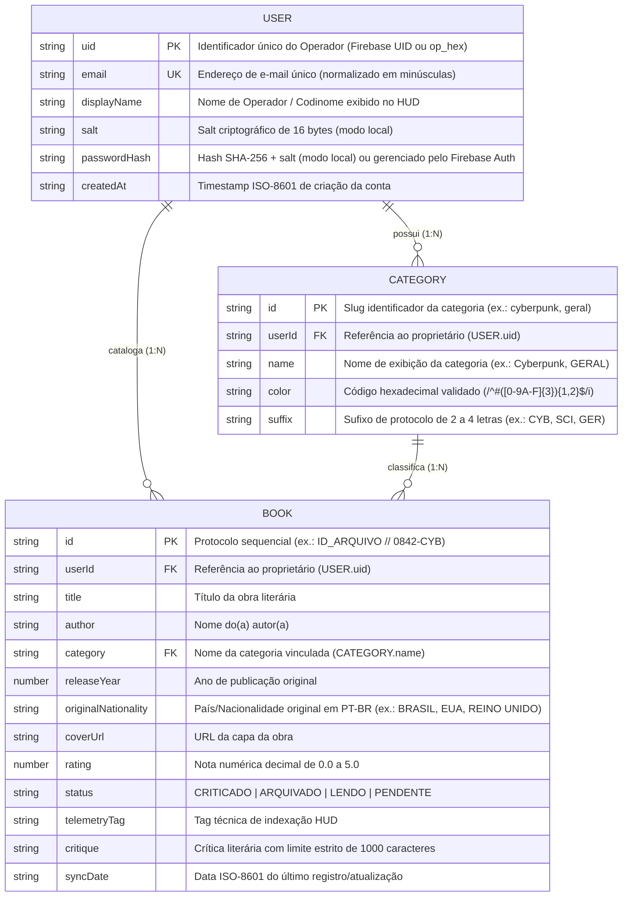
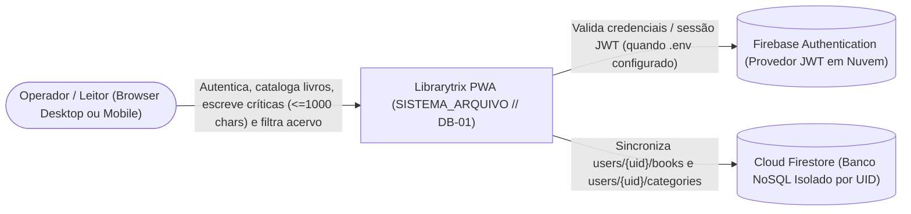
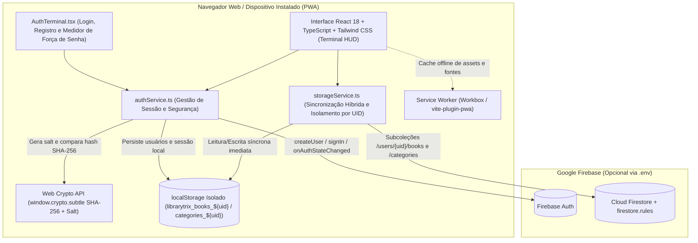
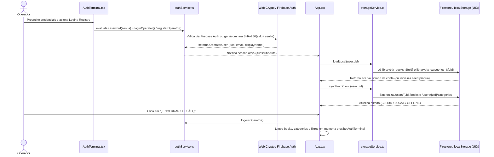

# Arquitetura de Software e Diagrama Entidade-Relacionamento (DER) — Librarytrix

---

## 1. Modelo Entidade-Relacionamento (DER)

O modelo de dados do **Librarytrix** é estruturado em torno do isolamento multiusuário: cada **Operador (`USER`)** possui seu próprio conjunto exclusivo de **Categorias (`CATEGORY`)** e **Livros (`BOOK`)**. No **Cloud Firestore**, esse relacionamento `1:N` é materializado através das subcoleções hierárquicas `/users/{uid}/categories/{categoryId}` e `/users/{uid}/books/{bookId}` protegidas por `firestore.rules`. No modo **Offline-First (`localStorage`)**, o isolamento é garantido pelo particionamento de chaves `librarytrix_categories_${uid}` e `librarytrix_books_${uid}`.

### Regras de Integridade do Modelo de Dados
1. **Isolamento por Proprietário (`userId`):** Nenhuma consulta ou gravação pode atravessar a fronteira de `USER.uid`. Validado no servidor por `isOwner(userId)` em `firestore.rules`.
2. **Integridade Referencial na Exclusão de Categoria:** Quando uma `CATEGORY` é excluída pelo operador, todos os registros `BOOK` cujo campo `category` aponta para `CATEGORY.name` são migrados atomicamente para a categoria padrão protegida `GERAL` (`color: #849495`, `suffix: GER`).
3. **Restrição de Domínio da Crítica Literária:** `BOOK.critique` possui comprimento máximo estrito de **1000 caracteres** (`critique.length <= 1000` no cliente e `data.critique.size() <= 1000` no `firestore.rules`).

---

## 2. Arquitetura C4 — Nível 1: Diagrama de Contexto

---

## 3. Arquitetura C4 — Nível 2: Diagrama de Contêineres

---

## 4. Arquitetura C4 — Nível 3: Diagrama de Componentes React

```mermaid
flowchart TD
  App["App.tsx (Orquestrador de Estado, Sessão, Filtros e Atalhos)"]

  App -->|"Se currentUser == null"| AuthTerminal["AuthTerminal.tsx (Login e Cadastro Multiusuário)"]
  App -->|"Se autenticado"| Header["Header.tsx (Busca 4 Campos CTRL+K, Avatar Iniciais, Logout)"]
  App -->|"Se autenticado"| Sidebar["Sidebar.tsx (Perfil do Operador, Categorias, Exportar, Logout)"]
  App -->|"Se autenticado"| TelemetryStrip["TelemetryStrip.tsx (4 Blocos Superiores Dinâmicos)"]
  App -->|"Se autenticado"| FilterBar["FilterBar.tsx (Chips de Categoria, Nota, País, Ordenação e Busca Mobile)"]
  App -->|"Visão: Catálogo"| BookCard["BookCard.tsx (Card Bento Grid HUD)"]
  App -->|"Visão: Ranking"| RankingView["RankingView.tsx (Classificação Geral #01-#03)"]
  App -->|"Mobile < 1024px"| BottomNav["BottomNav.tsx (Navegação Inferior)"]
  App --> Footer["Footer.tsx (Status de Sincronia e Segurança)"]

  App --> NewBookModal["NewBookModal.tsx (Criar / Editar Livro)"]
  App --> NewCategoryModal["NewCategoryModal.tsx (Criar Categoria + Cor Hexadecimal + Preview)"]
  App --> CritiqueModal["CritiqueModal.tsx (Leitura Integral da Crítica)"]
  App --> ConfirmCategoryDelete["ConfirmCategoryDelete.tsx (Confirmação de Exclusão -> GERAL)"]

  NewBookModal --> Modal1["Modal.tsx (<dialog> nativo)"]
  NewBookModal --> CritiqueEditor["CritiqueEditor.tsx (Limite 1000 Caracteres + Contador)"]
  NewCategoryModal --> Modal2["Modal.tsx"]
  CritiqueModal --> Modal3["Modal.tsx"]
  ConfirmCategoryDelete --> Modal4["Modal.tsx"]

  BookCard --> RatingBar["RatingBar.tsx (Barra HUD Segmentada de 5 Células)"]
  RankingView --> RatingBar
```

---

## 5. Diagrama de Sequência — Autenticação e Isolamento de Dados

