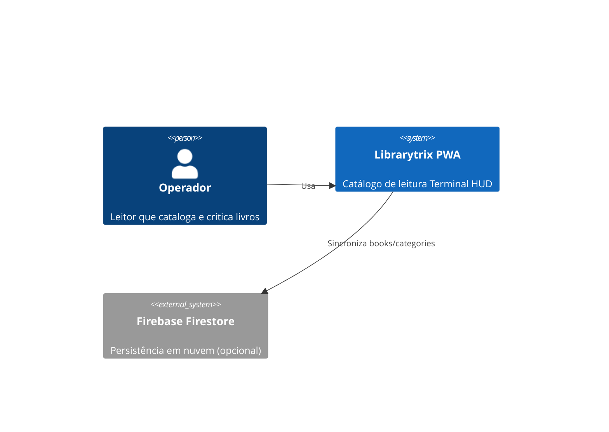
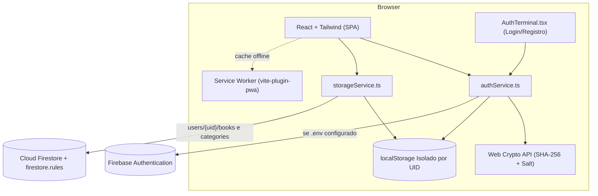
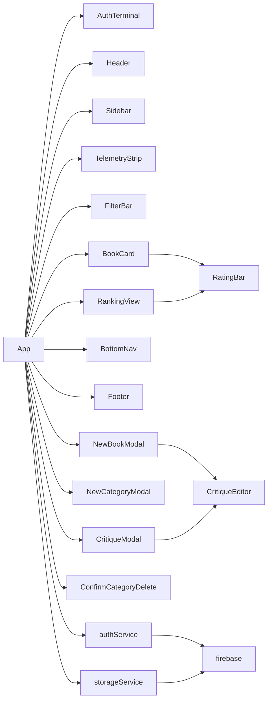
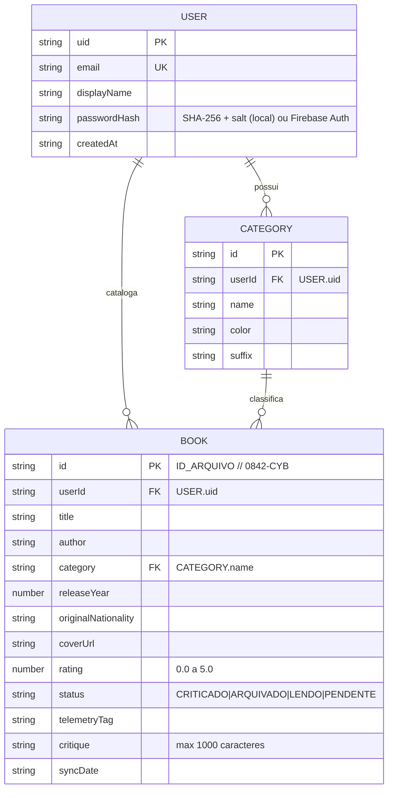
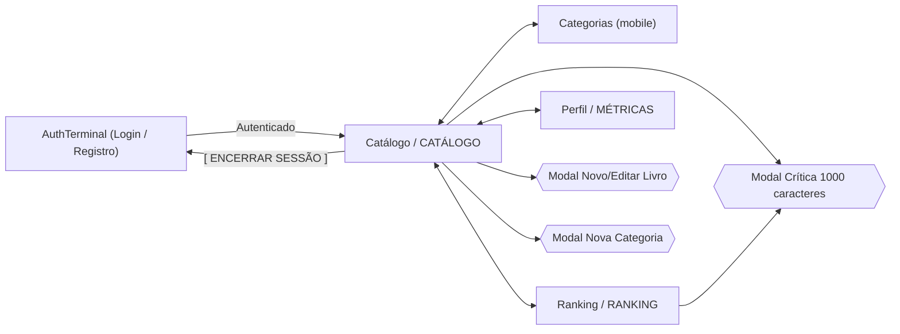

# Arquitetura e DER — Librarytrix

## C4 — Nível 1: Contexto

## C4 — Nível 2: Contêineres

## C4 — Nível 3: Componentes

## DER (Firestore e Isolamento por Conta)

> No Firestore, os documentos ficam isolados em `/users/{userId}/books/{bookId}` e `/users/{userId}/categories/{categoryId}`, protegidos por `firestore.rules` (`request.auth != null && request.auth.uid == userId`). No fallback local, as chaves são prefixadas por UID (`librarytrix_books_${uid}` e `librarytrix_categories_${uid}`).

## Fluxo de Telas

## Estratégia de Persistência e Segurança
1. **Autenticação:** `authService.ts` utiliza Firebase Auth quando `.env` está presente; sem `.env`, utiliza o cofre local com `window.crypto.subtle.digest('SHA-256', ...)` + *salt* exclusivo por operador (senhas nunca são salvas em texto puro).
2. **Isolamento de Dados:** `loadLocal(uid)` lê e grava em `librarytrix_books_${uid}` e `librarytrix_categories_${uid}`. Cada nova conta recebe seu próprio seed inicial independente.
3. **Sincronização Nuvem:** `syncFromCloud(uid)` sincroniza `/users/{uid}/books` e `/users/{uid}/categories`, com regras de segurança em `firestore.rules` validando propriedade do `uid` e `critique.size() <= 1000`.

