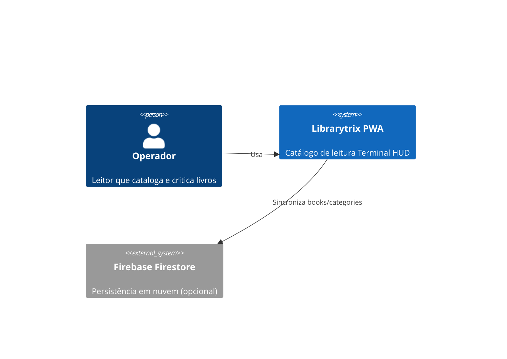
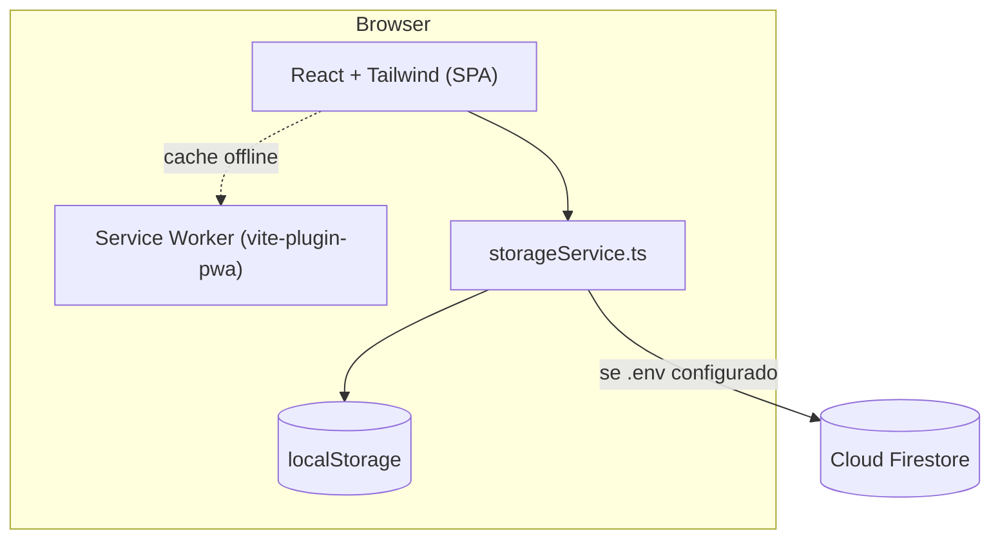
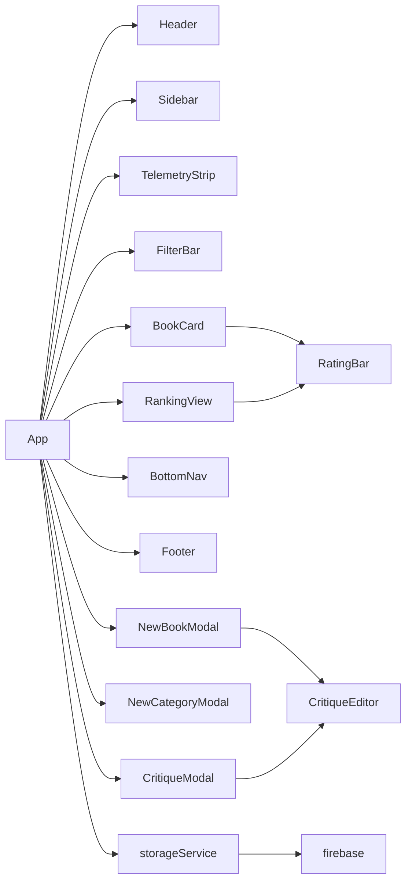
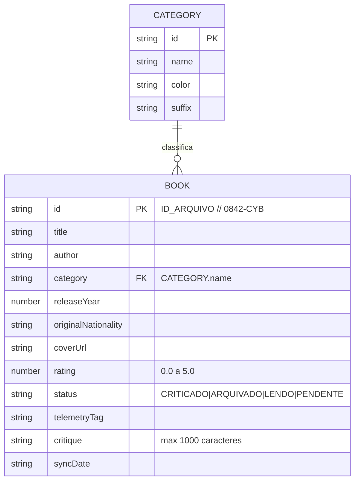
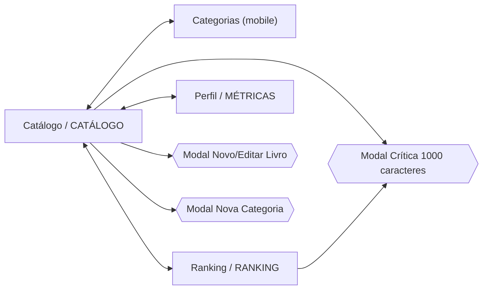

# Arquitetura e DER — Librarytrix

## C4 — Nível 1: Contexto

## C4 — Nível 2: Contêineres

## C4 — Nível 3: Componentes

## DER (Firestore)

> No Firestore, o ID de documento é o `id` sanitizado (`/` e espaços → `_`); o `id` de exibição permanece no campo.

## Fluxo de Telas

## Estratégia de Persistência
1. Boot: `loadLocal()` lê `localStorage` (pré-carregado com os 6 livros-semente).
2. Se o Firebase estiver configurado, `syncFromCloud()` busca `books`/`categories`; nuvem vazia → envia o seed local.
3. Escritas: `localStorage` sempre; Firestore em seguida. Falha → estado `OFFLINE` (dados locais preservados).

