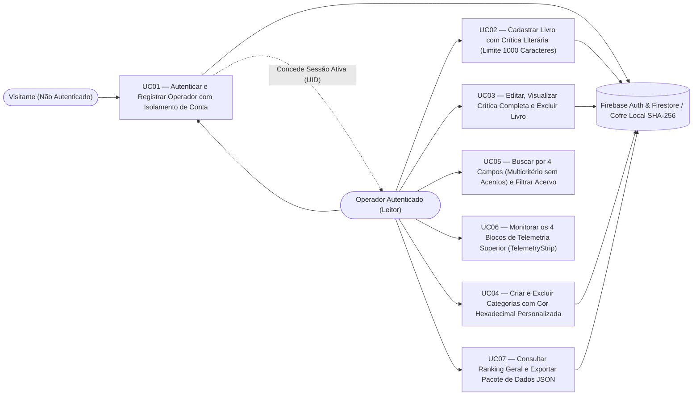

# Especificação Formal de Casos de Uso — Librarytrix

---

## 1. Catálogo de Atores

| Ator | Tipo | Descrição e Responsabilidades |
|------|------|-------------------------------|
| **Visitante (Operador Não Autenticado)** | Primário (Humano) | Usuário que acessa a aplicação sem sessão ativa. Visualiza exclusivamente o terminal de segurança `AuthTerminal`, podendo criar uma nova conta (`[ REGISTRAR NOVO OPERADOR ]`) ou autenticar-se (`[ AUTENTICAR OPERADOR ]`). |
| **Operador Autenticado (Leitor)** | Primário (Humano) | Usuário com sessão ativa validada por UID. Possui acesso total ao seu acervo isolado de livros e categorias, telemetria, busca multicritério, ranking, exportação JSON e encerramento de sessão. |
| **Serviço de Autenticação e Persistência (`authService` / `storageService`)** | Secundário (Sistema / Cloud) | Subsistema híbrido que integra o **Firebase Authentication / Cloud Firestore** (`users/{uid}/**`) e o provedor criptográfico local (`Web Crypto API SHA-256 + salt` e `localStorage` prefixado por `uid`). |

---

## 2. Diagrama Geral de Casos de Uso

---

## 3. Detalhamento dos Casos de Uso

### UC01 — Autenticar e Registrar Operador com Isolamento de Conta
- **Atores:** Visitante (Não Autenticado), Operador Autenticado, Serviço de Autenticação (`authService.ts`).
- **Requisitos Relacionados:** `[RF01]`, `[RF02]`, `[RNF03]`, `[RNF05]`.
- **Pré-condições:** A aplicação está carregada no navegador; quando não há sessão ativa, o acesso ao catálogo é bloqueado pelo `AuthTerminal`.
- **Fluxo Principal (Cadastro de Novo Operador):**
  1. O Visitante seleciona a aba `[ REGISTRAR NOVO OPERADOR ]` no `AuthTerminal`.
  2. O Visitante informa o **Nome de Operador / Codinome**, o **E-mail** e digita a **Chave de Acesso (Senha)**.
  3. O sistema avalia a senha em tempo real e atualiza o medidor em barras neon (`[ FRACA ]` em `#ff007f`, `[ MÉDIA ]` em `#ffb800` ou `[ FORTE ]` em `#39ff14`) e o checklist dos 4 requisitos (mínimo de 8 caracteres, 1 maiúscula, 1 minúscula e 1 número ou símbolo).
  4. O Visitante repete a senha no campo **Confirmar Chave de Acesso** e aciona `[ CRIAR CONTA E INICIALIZAR ACERVO ]`.
  5. O sistema cria a conta no Firebase Auth (ou gera *salt* de 16 bytes + hash `SHA-256` via `window.crypto.subtle.digest` no cofre local), inicializa o acervo isolado do novo `uid` com as 5 categorias padrão e 6 livros-semente (`users/{uid}/**` e `librarytrix_books_${uid}`) e abre o catálogo exibindo o nome real e as iniciais do operador no cabeçalho e na Sidebar.
- **Fluxo Alternativo A1 — Login de Operador Existente:**
  1. Na aba `[ AUTENTICAR OPERADOR ]`, o usuário informa E-mail e Senha e clica em `[ INICIAR SESSÃO DO OPERADOR ]`.
  2. O sistema valida as credenciais e carrega exclusivamente os livros e categorias vinculados ao `uid` daquele operador.
- **Fluxo Alternativo A2 — Mostrar/Ocultar Senha:**
  1. O usuário clica no botão `[ MOSTRAR ]` / `[ OCULTAR ]` ao lado do campo de senha para inspecionar os caracteres digitados.
- **Fluxo Alternativo A3 — Encerrar Sessão (Logout):**
  1. O Operador Autenticado clica em `[ ENCERRAR SESSÃO ]` no cabeçalho, na Sidebar ou na aba Sistema/Métricas.
  2. O sistema encerra a sessão, limpa imediatamente os arrays de livros, categorias e filtros em memória e retorna à tela `AuthTerminal`.
- **Fluxos de Exceção:**
  - **E1 (Senha Fraca ou Confirmação Divergente):** O sistema impede a submissão e exibe alerta em PT-BR (`ERRO DE SEGURANÇA` ou `ERRO DE VALIDAÇÃO`).
  - **E2 (E-mail Já Cadastrado):** O sistema exibe `ERRO DE REGISTRO: Este endereço de e-mail já está cadastrado no sistema.`
  - **E3 (Credenciais Inválidas / Bloqueio por Força Bruta):** Após 5 tentativas incorretas consecutivas, o sistema bloqueia temporariamente a conta por 60 segundos (`BLOQUEIO DE SEGURANÇA: Excesso de tentativas falhas`).
- **Pós-condições:** O operador autenticado acessa apenas seu próprio acervo isolado; nenhuma senha é armazenada em texto puro.

---

### UC02 — Cadastrar Livro com Crítica Literária (Limite de 1000 Caracteres)
- **Atores:** Operador Autenticado, Serviço de Persistência (`storageService.ts`).
- **Requisitos Relacionados:** `[RF03]`, `[RF05]`, `[RF06]`, `[RF07]`, `[RNF04]`, `[RNF05]`.
- **Pré-condições:** Operador autenticado no sistema.
- **Fluxo Principal:**
  1. O Operador clica no botão `[ + NOVO LIVRO ]` no cabeçalho.
  2. O sistema abre o modal `NOVO REGISTRO DE LIVRO`.
  3. O Operador preenche **Título**, **Autor**, seleciona a **Categoria**, informa **Ano de Lançamento**, **Nacionalidade Original**, **Nota (`0.0` a `5.0`)**, **Status de Leitura**, **URL da Capa** e **Tag de Telemetria**.
  4. No campo `TERMINAL DE CRÍTICA V4.0 // LIMITE: 1000 CARACTERES`, o Operador digita sua crítica literária acompanhando o contador em tempo real `CARACTERES: XXX / 1000`.
  5. O Operador confirma clicando em `[ SALVAR CRÍTICA ]` (ou pressionando `CTRL+ENTER`).
  6. O sistema gera o identificador `ID_ARQUIVO // NNNN-SUF`, associa o `userId` do operador, persiste o livro em `librarytrix_books_${uid}` e `users/{uid}/books`, fecha o modal e atualiza o Bento Grid e os 4 blocos de telemetria.
- **Fluxo Alternativo A1 — Cancelamento:**
  1. O Operador clica em `[ FECHAR_X ]` ou `[ CANCELAR ]`; o modal é fechado sem gravar alterações.
- **Fluxos de Exceção:**
  - **E1 (Campos Obrigatórios ou Nota Inválida):** Caso título/autor estejam vazios ou a nota esteja fora do intervalo `0.0`–`5.0`, o sistema exibe alerta `ERRO:` e mantém o modal aberto.
  - **E2 (Limite de 1000 Caracteres Atingido):** Ao passar de 900 caracteres, o contador muda para amarelo (`#ffb800`); ao atingir 1000 caracteres, muda para magenta (`#ff007f`) e bloqueia a inserção de novos caracteres (`maxLength={1000}` e validação `critique.length <= 1000`).
- **Pós-condições:** Livro gravado no acervo isolado do operador com crítica de no máximo 1000 caracteres.

---

### UC03 — Editar, Visualizar Crítica Completa e Excluir Livro
- **Atores:** Operador Autenticado, Serviço de Persistência.
- **Requisitos Relacionados:** `[RF04]`, `[RF07]`, `[RF08]`.
- **Pré-condições:** Existir ao menos um livro cadastrado na conta do operador.
- **Fluxo Principal (Leitura e Edição):**
  1. No card do livro, o Operador clica em `[ VER CRÍTICA COMPLETA ]`.
  2. O sistema exibe o modal `TERMINAL DE CRÍTICA V4.0 // LIMITE: 1000 CARACTERES` com o texto integral da crítica, nota, categoria e data `REGISTRADO EM:`.
  3. O Operador clica em `[ EDITAR NO REGISTRO ]` (ou diretamente no ícone `edit` do card).
  4. O sistema abre o modal de edição preenchido com os dados do livro; o Operador altera os campos desejados e salva em `[ SALVAR CRÍTICA ]`.
- **Fluxo Alternativo A1 — Exclusão de Livro:**
  1. O Operador clica no ícone `delete` no card do livro.
  2. O sistema solicita confirmação (`Excluir "<Título>" do acervo?`).
  3. Ao confirmar, o livro é removido do `localStorage` e da subcoleção `users/{uid}/books` do Firestore, recalculando a telemetria imediatamente.
- **Fluxo de Exceção E1 — Falha de Rede na Nuvem:**
  1. Se o Firestore estiver inacessível no momento da edição/exclusão, a alteração é preservada localmente e o indicador de rodapé muda para `OFFLINE`.

---

### UC04 — Criar e Excluir Categorias com Código Hexadecimal Personalizado
- **Atores:** Operador Autenticado, Serviço de Persistência.
- **Requisitos Relacionados:** `[RF09]`, `[RF10]`, `[RNF02]`, `[RNF09]`.
- **Pré-condições:** Operador autenticado.
- **Fluxo Principal (Criação com Cor Hexadecimal):**
  1. O Operador aciona `[ + NOVA CATEGORIA ]` (na Sidebar, nos Filter Chips ou via atalho `ALT+N`).
  2. Informa o nome em `NOME DA CATEGORIA >` e o sufixo de protocolo (2 a 4 letras).
  3. Escolhe uma cor clicando em um dos presets Neon Phosphor, **digitando manualmente um código hexadecimal** (ex.: `#FF0055`) ou selecionando no `<input type="color">` sincronizado.
  4. O sistema atualiza instantaneamente a `PRÉ-VISUALIZAÇÃO DA ETIQUETA` com a cor escolhida.
  5. O Operador clica em `[ REGISTRAR NO BANCO ]`; o sistema valida o formato `/^#([0-9A-F]{3}){1,2}$/i`, normaliza códigos de 3 dígitos (`#0FF` → `#00FFFF`) e salva a categoria na conta do usuário.
- **Fluxo Alternativo A1 — Exclusão de Categoria com Migração para `GERAL`:**
  1. O Operador clica no botão de exclusão (`delete` / `[X]`) de uma categoria na Sidebar, nos Filter Chips ou na aba Categorias.
  2. O sistema abre o modal `CONFIRMAR EXCLUSÃO // Deseja remover esta categoria?` informando quantos livros estão vinculados a ela.
  3. O Operador confirma em `[ CONFIRMAR_EXCLUSÃO ]`.
  4. O sistema exclui a categoria e reatribui automaticamente todos os livros afetados para a categoria `GERAL` (`#849495`), criando-a se necessário.
- **Fluxos de Exceção:**
  - **E1 (Hexadecimal Inválido ou Nome Duplicado):** Exibe mensagem de erro (`ERRO: cor hexadecimal inválida (ex.: #00F0FF).` ou `ERRO: categoria já existe.`) e impede a gravação.
  - **E2 (Proteção da Categoria `GERAL`):** A categoria padrão `GERAL` não exibe botão de exclusão.
- **Pós-condições:** Categorias atualizadas com cores aplicadas via `style` inline dinâmico; nenhum livro fica sem categoria válida.

---

### UC05 — Buscar por 4 Campos (Multicritério sem Acentos) e Filtrar Acervo
- **Atores:** Operador Autenticado.
- **Requisitos Relacionados:** `[RF12]`, `[RF13]`, `[RNF08]`.
- **Pré-condições:** Operador autenticado na visão de Catálogo.
- **Fluxo Principal:**
  1. O Operador foca a barra `BUSCAR >` (no cabeçalho Desktop, na barra Mobile ou pressionando `CTRL+K` / `⌘K`) e digita um termo de pesquisa.
  2. A cada caractere digitado, o sistema normaliza o termo e os campos dos livros (`normalize('NFD').replace(/[\u0300-\u036f]/g, '').toLowerCase()`) e verifica se o termo está contido em **qualquer um dos 4 campos**:
     - Nome do Livro (`book.title`)
     - Nome do Autor (`book.author`)
     - Nacionalidade Original (`book.originalNationality`)
     - Categoria (`book.category`)
  3. O Operador opcionalmente combina a busca textual com os filtros de **Categoria**, **Nota Mínima** (`5.0 ★`, `4.5+ ★`, `4.0+ ★`, `TODOS`) e **Nacionalidade**.
  4. O Bento Grid e o contador de resultados são atualizados instantaneamente.
- **Fluxo Alternativo A1 — Limpeza Rápida pelo Botão `[ X ]`:**
  1. Quando `searchQuery` não está vazio, o Operador clica no botão `[ X ]` dentro do input de busca para limpar o texto e restaurar a listagem imediatamente.
- **Fluxo de Exceção E1 — Nenhum Registro Encontrado:**
  1. Caso nenhum livro corresponda aos critérios ativos, o grid renderiza o painel estilizado `NENHUM REGISTRO ENCONTRADO PARA A BUSCA ATUAL` com o botão `[ LIMPAR FILTROS ]`, que redefine todos os filtros e a busca com um clique.

---

### UC06 — Monitorar os 4 Blocos de Telemetria Superior (`TelemetryStrip`)
- **Atores:** Operador Autenticado.
- **Requisitos Relacionados:** `[RF11]`, `[RNF08]`.
- **Pré-condições:** Operador autenticado visualizando o Catálogo ou a aba Métricas.
- **Fluxo Principal:**
  1. O sistema processa o acervo do operador em tempo real e renderiza os 4 blocos superiores:
     - **Bloco 1 (`REGISTROS // TOTAL` | `SIS:ATIVO`):** Exibe o total absoluto de livros da conta (`X Vol`), `Codex Principal` e a quantidade de categorias ativas (ou itens exibidos no filtro atual).
     - **Bloco 2 (`MÉTRICA // GERAL` ou `MÉTRICA // [CATEGORIA]`):** Quando `TODOS` está selecionado, exibe a média aritmética global de todos os livros (`Média Global do Site` e `AVALIADOS: X%`). Quando uma categoria específica é selecionada, recalcula a média apenas dos livros daquela categoria (`X Vols na Categoria`) e aplica dinamicamente a cor hexadecimal da categoria ao valor principal, texto de destaque e borda inferior.
     - **Bloco 3 (`ÚLTIMO REGISTRO // ADIÇÃO` | `RECÉM ADICIONADO`):** Exibe o título truncado em 1 linha do último livro cadastrado, seu autor à esquerda e a categoria + nota (`X.X ★`) na cor da categoria à direita.
     - **Bloco 4 (`DADOS // DOMINÂNCIA` | `MAIOR CATEGORIA`):** Identifica a categoria com maior número de livros no acervo, exibindo seu nome, percentual de dominância, `X Vols registrados` e a 2ª maior categoria, estilizados com a cor hexadecimal da categoria líder.
- **Fluxos de Exceção / Estados Vazios:**
  - **E1 (Categoria Selecionada Sem Livros):** O Bloco 2 exibe `0.0 ★ MÉDIA` e `Sem registros`.
  - **E2 (Acervo Sem Livros):** O Bloco 3 exibe `NENHUM REGISTRO` e `Aguardando indexação...`.

---

### UC07 — Consultar Ranking Geral e Exportar Pacote de Dados JSON
- **Atores:** Operador Autenticado.
- **Requisitos Relacionados:** `[RF14]`, `[RF15]`.
- **Pré-condições:** Operador autenticado.
- **Fluxo Principal (Ranking):**
  1. O Operador acessa a visão `RANKING` no cabeçalho ou na barra inferior mobile.
  2. O sistema exibe a lista `RANKING // CLASSIFICAÇÃO GERAL` ordenada decrescentemente por nota, destacando os 3 primeiros colocados (`#01`, `#02`, `#03`) e permitindo abrir a crítica completa de qualquer obra.
- **Fluxo Alternativo A1 — Exportação JSON:**
  1. O Operador clica em `[ SALVAR PACOTE DE DADOS ]` (Sidebar, FilterBar ou aba Sistema).
  2. O navegador baixa imediatamente o arquivo `librarytrix-backup-AAAA-MM-DD.json` contendo os metadados do operador, suas categorias e seus livros.
