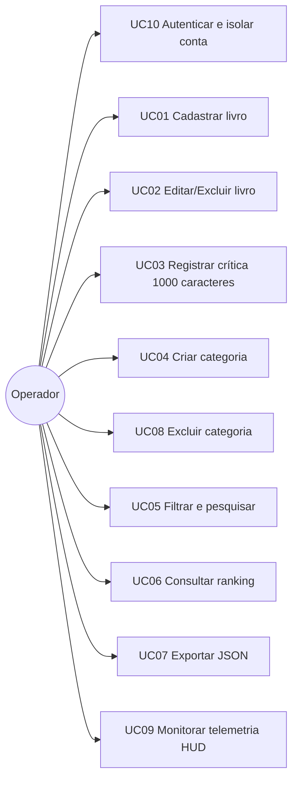

# Casos de Uso — Librarytrix

**Ator principal:** Operador (leitor). **Sistema:** Librarytrix.

## UC01 — Cadastrar livro
- **Pré-condição:** app carregado.
- **Fluxo principal:** 1) Operador clica `[ + NOVO LIVRO ]`. 2) Preenche título, autor, categoria, ano, país, nota, status, capa e tag. 3) Opcionalmente escreve a crítica. 4) Confirma com `[ SALVAR CRÍTICA ]`. 5) Sistema gera `ID_ARQUIVO // NNNN-SUF`, grava e exibe o card.
- **Fluxo alternativo A1:** Operador cancela em `[ FECHAR_X ]` → nada é gravado.
- **Fluxo de exceção E1:** título/autor vazio, nota fora de 0–5 ou ano inválido → mensagem `ERRO:` e o modal permanece aberto.
- **Pós-condição:** livro persistido (Firestore e/ou `localStorage`).

## UC02 — Editar/Excluir livro
- **Principal:** Operador clica no ícone de edição → altera campos → confirma; ou clica em excluir → confirma o diálogo → livro removido.
- **Alternativo:** Operador recusa a confirmação de exclusão → nada muda.
- **Exceção:** falha no Firestore → mantém alteração local e marca sincronia `OFFLINE`.

## UC03 — Registrar e visualizar crítica (limite máximo de 1000 caracteres)
- **Principal (Cadastro/Edição):** 1) Operador abre o formulário de Novo/Editar Livro. 2) Digita a crítica no campo `TERMINAL DE CRÍTICA V4.0 // LIMITE: 1000 CARACTERES` acompanhando o contador `CARACTERES: XXX / 1000`. 3) Confirma em `[ SALVAR CRÍTICA ]` (ou `CTRL+ENTER`). 4) Sistema grava o livro com a crítica e atualiza `syncDate`.
- **Alternativo (Visualização completa):** Operador clica em `[ VER CRÍTICA COMPLETA ]` no card do livro → sistema abre o modal de leitura com o texto integral da crítica e opção `[ EDITAR NO REGISTRO ]`.
- **Exceção:** ao atingir 1000 caracteres o campo bloqueia novas entradas (contador magenta `#ff007f`; amarelo `#ffb800` acima de 900).

## UC04 — Criar categoria
- **Principal:** Operador abre `+ NOVA CATEGORIA` (ou `ALT+N`) → informa nome em `NOME DA CATEGORIA >` → escolhe um preset neon **ou digita um código hexadecimal** (ex.: `#FF0055`) / usa o seletor visual `<input type="color">`, vendo a `PRÉ-VISUALIZAÇÃO DA ETIQUETA` em tempo real → define sufixo (2–4 letras) → `[ REGISTRAR NO BANCO ]`.
- **Alternativo:** Código de 3 dígitos (`#0FF`) é normalizado para 6 (`#00FFFF`).
- **Exceção:** nome duplicado/vazio, hexadecimal fora de `/^#([0-9A-F]{3}){1,2}$/i` ou sufixo inválido → `ERRO:` exibido e nada é gravado.

## UC05 — Filtrar e pesquisar
- **Principal:** Operador seleciona categoria (sidebar/chips), nota mínima, nacionalidade e/ou digita em `BUSCAR >` (Desktop ou Mobile, atalho `CTRL+K` / `⌘K`) → o sistema normaliza acentos e maiúsculas/minúsculas e verifica se o termo está contido no **título**, **autor**, **nacionalidade original** ou **categoria**, atualizando a lista em tempo real.
- **Alternativo:** Operador clica em `[ X ]` dentro do input de busca para limpar rapidamente o termo digitado.
- **Exceção:** nenhum resultado → exibe estado vazio estilizado com a mensagem `NENHUM REGISTRO ENCONTRADO PARA A BUSCA ATUAL` e o botão `[ LIMPAR FILTROS ]`.

## UC06 — Consultar ranking
- **Principal:** Operador abre `RANKING` → vê livros por nota (`RANKING // CLASSIFICAÇÃO GERAL`) com medalhas #01–#03.

## UC07 — Exportar JSON
- **Principal:** Operador clica `EXPORTAR JSON`/`[ SALVAR PACOTE DE DADOS ]` → navegador baixa `librarytrix-backup-AAAA-MM-DD.json` com livros e categorias.

## UC08 — Excluir categoria
- **Pré-condição:** existe ao menos uma categoria diferente de `GERAL`.
- **Principal:** 1) Operador clica no ícone `delete` / `[X]` da categoria (Sidebar, chips mobile ou aba Categorias). 2) Sistema exibe `CONFIRMAR EXCLUSÃO // Deseja remover esta categoria?` com a quantidade de livros afetados. 3) Operador confirma em `[ CONFIRMAR_EXCLUSÃO ]`. 4) Sistema remove a categoria, reatribui livros vinculados à categoria `GERAL` (`#849495`, criada automaticamente se necessário) e atualiza contadores e filtros.
- **Alternativo:** Operador cancela → nada muda.
- **Exceção:** a categoria `GERAL` não pode ser excluída; falha no Firestore → alteração mantida localmente e sincronia `OFFLINE`.
- **Pós-condição:** nenhum livro fica sem categoria válida.

## UC09 — Monitorar telemetria superior (TelemetryStrip)
- **Pré-condição:** app carregado no Catálogo ou Perfil/Métricas.
- **Principal:** 1) O sistema calcula e exibe os 4 blocos de telemetria:
  - **Bloco 1 (`REGISTROS // TOTAL` | `SIS:ATIVO`):** total absoluto de volumes no acervo (`X Vol`), com `Codex Principal` e total de categorias ativas (ou itens filtrados) no rodapé.
  - **Bloco 2 (`MÉTRICA // GERAL` ou `MÉTRICA // [CATEGORIA]`):** quando `TODOS` está ativo, exibe a média global do site (`Média Global do Site` e `AVALIADOS: X%`); quando uma categoria é selecionada na Sidebar ou nos Filter Chips, recalcula a média apenas daquela categoria (`X Vols na Categoria`) e aplica a cor Hexadecimal da categoria ao valor principal, destaque e barra inferior.
  - **Bloco 3 (`ÚLTIMO REGISTRO // ADIÇÃO` | `RECÉM ADICIONADO`):** exibe o título truncado do último livro cadastrado, seu autor à esquerda e a categoria + nota (`X.X ★`) na cor da categoria à direita.
  - **Bloco 4 (`DADOS // DOMINÂNCIA` | `MAIOR CATEGORIA`):** exibe a categoria com mais livros, seu percentual no acervo, `X Vols registrados` e a 2ª categoria (ou total de categorias), estilizados com a cor Hexadecimal da categoria dominante.
- **Exceções / Estados vazios:**
  - Categoria selecionada sem livros → Bloco 2 exibe `0.0 ★ MÉDIA` e `Sem registros`.
  - Acervo sem nenhum livro → Bloco 3 exibe `NENHUM REGISTRO` e `Aguardando indexação...`.

## UC10 — Autenticação e Isolamento de Conta de Usuário
- **Pré-condição:** operador não autenticado visualiza exclusivamente a tela `AuthTerminal`.
- **Fluxo principal (Registro):** 1) Operador seleciona a aba `[ REGISTRAR NOVO OPERADOR ]`. 2) Informa Nome de Operador/Codinome, E-mail, Senha (acompanhando o indicador `FRACA` / `MÉDIA` / `FORTE`) e Confirmação de Senha. 3) Clica em `[ CRIAR CONTA E INICIALIZAR ACERVO ]`. 4) O sistema valida os requisitos de segurança da senha, cria a conta no Firebase Auth (ou gera *salt* + hash `SHA-256` no cofre local), inicializa o acervo isolado do UID (`users/{uid}/books` e `users/{uid}/categories` / `librarytrix_books_${uid}`) e libera o acesso ao catálogo exibindo o nome e as iniciais do operador no cabeçalho e na Sidebar.
- **Fluxo alternativo A1 (Login):** Operador seleciona `[ AUTENTICAR OPERADOR ]`, informa E-mail e Senha e clica em `[ INICIAR SESSÃO DO OPERADOR ]` → o sistema valida as credenciais e carrega apenas os livros e categorias pertencentes àquele `uid`.
- **Fluxo alternativo A2 (Logout):** Operador clica em `[ ENCERRAR SESSÃO ]` no cabeçalho ou na Sidebar → o sistema limpa imediatamente o estado em memória, encerra a sessão e retorna para o `AuthTerminal`.
- **Fluxo de exceção E1:** senha com menos de 8 caracteres ou sem maiúscula/minúscula/número-ou-símbolo, confirmação divergente, e-mail já cadastrado ou 5 tentativas inválidas consecutivas → o sistema exibe mensagem de erro em PT-BR e bloqueia o acesso.
- **Pós-condição:** nenhum operador consegue visualizar ou modificar livros ou categorias de outra conta.

